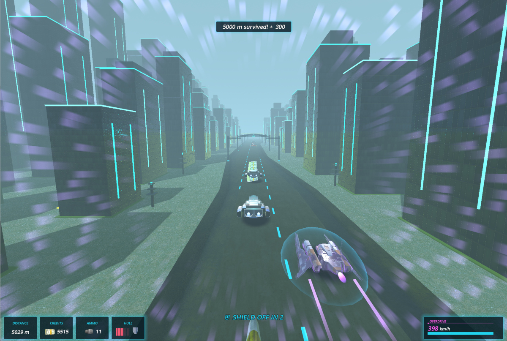

# DashOut 🏁

A futuristic endless racer built with **Godot 4.7.2**. Collect power-ups, upgrade your ship, earn new effects and tracks — and break the speed record!



---

## 📦 Requirements

- **Godot 4.7.2** (developed and tested with this version; the Forward+ renderer is used, so no compatibility-mode restrictions apply)
- Any desktop platform supported by Godot (Windows, macOS, Linux)

> Older Godot 4.x versions may work but are untested; Godot 3.x will **not** work.

## 🚀 Download & Run

1. **Get the project**
   - Clone the repository:
     ```bash
     git clone https://github.com/<your-user>/dashout.git
     cd dashout
     ```
   - …or download the ZIP via the green **Code → Download ZIP** button and extract it.

2. **Open it in Godot**
   - Launch Godot 4.7.2.
   - In the Project Manager click **Import**, select the project's `project.godot` file, and confirm.
   - Once the import finishes, open the project and press **F5** (or the ▶ button) to run.

3. **Optional: make a standalone build**
   - Open **Project → Export…**, add a preset for your platform (you may need to download the matching export templates via **Editor → Manage Export Templates**), and export.

No additional plugins or assets are required — everything the game needs ships with the repository.

## 🎮 Gameplay

You pilot a hover-ship down an endlessly scrolling neon highway at up to **~396 km/h** (and far beyond with Overdrive). Traffic comes at you from ahead and behind, lanes close without warning, and the road narrows and widens. Survive as long as you can, grab pickups, and cash in for upgrades in the garage.

### How to play

| Input | Action |
| --- | --- |
| ← / → or A / D | Change lane |
| ↑ / W | Accelerate (hold at max to build **Overdrive**) |
| ↓ / S | Brake (drops Overdrive) |
| SPACE (tap) | Fire plasma shot (uses ammo) |
| SPACE (hold ~3 s) | Charge and release a **SUPER SHOT** shockwave (9 ammo) |
| ESC | Pause / back |
| F | Toggle fullscreen |

### Pickups

- 💵 **Cash** — money for the garage.
- ❤ **Life** — restores one hull bar (up to 9). You start each run with 3; lose the last one and the run ends in a fiery explosion.
- ⛨ **Shield** — temporary invulnerability dome. Ram traffic while shielded to smash through it — and the dome *surges* on impact.
- 🔫 **Ammo** — loads the mini-gun for plasma shots and SUPER SHOTs.

### Risk pays

- Flying past traffic at close range triggers **near misses** that ripple your shield.
- Changing lane right before it closes, or with traffic right next to you, earns an **edge bonus** — but only if you survive the next second. Crashing cancels it.
- Holding full throttle builds **Overdrive**: a speed bonus above the normal cap that shatters the record — but a single crash or braking forfeits it.

### Between runs: the Garage

Spend your cash on:

- **Ship models** — different hulls with their own handling flavour (the slim ship is the free default).
- **Upgrades** — permanent perks such as the Quantum Recycler (longer shields).
- **Track skins** — different scenery themes for the highway.
- **Effects** — freely customize the colour of your exhaust flame, plasma shots and Overdrive glow.

### Scoring

Runs are scored from distance, top speed, collected cash, pickup-collection percentage and destroyed traffic. High scores are kept locally, and every run summary shows exactly where you placed.

## 🗂 Project structure

```
project.godot
scripts/        # all GDScript gameplay code
models/         # imported GLB ship & pickup models
textures/       # CC0 PBR textures (ambientCG)
Music/, sfx/    # CC0 music and sound effects
```

All music and most sound effects are **generated procedurally at runtime** — the external files are optional overrides.

## 📜 Asset licenses

Game code: 

The game code was developed with major input and review by generative AI tools, such as Mistral Vibe and ChatGPT. I therefore do not want to put any restrictive license on this code. It is, in essence, derivative of an impossibly extensive amount of training data that these models use. The end result, as it is published here, does however depend majorly on my work and other people's. If you like please feel free to acknowledge this as a credit.

Third-party assets used (all **CC0** unless noted):

| Asset | Source | Author / License |
| --- | --- | --- |
| `alienshoot3` (sfx) | [opengameart.org](https://opengameart.org/content/space-shoot-sounds) | Robin Lamb, CC0 |
| *A Block in Space* (menu music) | [opengameart.org](https://opengameart.org/content/a-block-in-space) | Umplix, CC0 |
| *Trace Agent* (race music) | [opengameart.org](https://opengameart.org/content/trace-agent) | Vitalezzz, CC0 |
| Dispatcher / Imperial / Insurgent / Striker ships | [opengameart.org](https://opengameart.org/content/lowpoly-spaceships-pack) | quaternius, CC0 |
| traffic_yellow / traffic_red | [opengameart.org](https://opengameart.org/content/scifi-hoverships) | knekko, CC0 |
| ammo box | [opengameart.org](https://opengameart.org/content/ammo-box-pack) | Yughues, CC0 |
| dollar | [opengameart.org](https://opengameart.org/content/dollars-pack) | wobba89, CC0 |
| heart | [opengameart.org](https://opengameart.org/content/kaykit-mini-game-variety-pack-12) | Kay Lousberg, CC0 |
| shield | [opengameart.org](https://opengameart.org/content/kite-shield-1) | Lucian Pavel, CC0 |
| player_slim (FEISAR ship) | [cgtrader.com](https://www.cgtrader.com/free-3d-models/vehicle/sci-fi-vehicle/feisar-ship) | vertexus, Royalty Free License (no AI) |
| Textures | [ambientcg.com](https://ambientcg.com/) | CC0 |

> ⚠️ Note: the *player_slim* models is **not** CC0. If you redistribute this project, check those two licenses (the CGTrader Royalty Free License in particular restricts redistribution of the raw asset) or replace them.

## 🤝 Contributing

Contributions are welcome!

1. Fork the repository and create a branch for your change.
2. Keep code style consistent: **TAB indentation**, GDScript 2.0 (Godot 4.x) idioms, and the existing component architecture (`main.gd` orchestrates, `RaceSession` owns state, `EntityManager` owns entities, UI lives in its own scripts).
3. Test your change in Godot **4.7.2** before opening a pull request, and describe what you changed and how you tested it.
4. New assets should be comparably permissive, at the minimum free to use, share and remix — include the source and license in the credits table above.

Good first contributions: bug fixes, tuning gameplay balance, improving comments/docs.

## 🗺 Roadmap

- **Fix issues** — squash rendering and gameplay bugs (e.g. real-time sun shadows on the road are currently limited by a Godot engine issue; ships use blob shadows as a workaround until the engine fix lands).
- **Better models** — replace remaining procedural placeholder geometry with proper GLB models, and improve materials/lighting on the imported ships.
- **More player ships** — additional purchasable hulls with distinct stats and handling.
- **More upgrades & pickups** — new permanent upgrades in the garage and new pickup types on the road.
- **Richer scenery** — more track themes, varied environments (tunnels, canyons, city districts), and dynamic weather/time-of-day.
- **Gameplay balance & progression** — smoother difficulty curve, meaningful run-to-run progression, and rebalanced cash/economy so every garage item feels worth earning.

---

*DashOut — break the speed record.* ⚡
